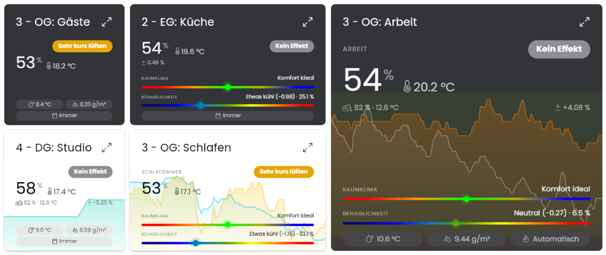

# 💦 Luftfeuchtigkeitssensor (Humidity Sensor)

[](https://wilkware.de/module/luftfeuchtigkeitssensor/)
[](https://www.symcon.de/service/dokumentation/entwicklerbereich/sdk-tools/sdk-php/)
[](https://www.symcon.de/produkt/)
[](https://github.com/Wilkware/HumiditySensor)
[](https://creativecommons.org/licenses/by-nc-sa/4.0/)
[](https://github.com/Wilkware/HumiditySensor/actions)

Das Modul Luftfeuchtigkeitssensor (Humidity Sensor) berechnet anhand der Innen- und Außentemperatur sowie der Innen- und Außenluftfeuchtigkeit den Wassergehalt der Luft und den Taupunkt und ermittelt so, ob ein Lüften des Raumes von Vorteil wäre.



## Inhaltsverzeichnis

1. [Funktionsumfang](#user-content-1-funktionsumfang)
2. [Voraussetzungen](#user-content-2-voraussetzungen)
3. [Installation](#user-content-3-installation)
4. [Einrichtung](#user-content-4-einrichtung)
5. [Statusvariablen](#user-content-5-statusvariablen)
6. [Darstellungen](#user-content-6-darstellungen)
7. [Visualisierung](#user-content-7-visualisierung)
8. [Befehlsreferenz](#user-content-8-befehlsreferenz)
9. [Versionshistorie](#user-content-9-versionshistorie)

### 1. Funktionsumfang

* Berechnung des Wassergehaltes (absolute Feuchte) der Luft für innen und außen
* Berechnung des Taupunktes der Luft für innen und außen
* Berechnung der Differenz des Wassergehaltes zwischen Innen- und Außenluft
* Berechnung des Hitzeindex (gefühlte Temperatur) für innen inkl. Warnstufe
* Bewertung des Raumklimas (Komfortindex) nach der ELV-Komfortanzeige
* Berechnung der thermischen Behaglichkeit (PMV/PPD) nach ISO 7730
* Optionaler thermischer Zustand (zu kühl/behaglich/zu warm) mit Hysterese, z. B. als Auslöser für Beschattung oder Lüfter
* Berechnung bei Änderung der Messwerte (gebündelt) oder zyklisch, optional Kopie der Messwerte als Statusvariablen
* Hinweis, ob ein Lüften des Raumes angebracht wäre
* Textuelle Erklärung für die Entscheidung
* Eigene, an die Größe angepasste Kachel für die Kachel-Visualisierung mit wählbaren Elementen und Feuchteverlauf aus dem Archiv
* Benachrichtigung über Meldungsskript (Dashboard) oder Push-Nachricht an die Visualisierung (WebFront oder Kachel-Visualisierung)

### 2. Voraussetzungen

* Symcon ab Version 8.1

### 3. Installation

* Über den Modul Store das Modul _Luftfeuchtigkeitssensor_ installieren.
* Alternativ über das Modul Control folgende URL hinzufügen.  
`https://github.com/Wilkware/HumiditySensor` oder `git://github.com/Wilkware/HumiditySensor.git`

### 4. Einrichtung

* Unter 'Instanz hinzufügen' ist das _Luftfeuchtigkeitssensor_-Modul (Alias: _Luftfeuchtigkeitsrechner_) unter dem Hersteller '(Geräte)' aufgeführt.

__Konfigurationsseite__:

Einstellungsbereich:

> 🌡️ Klimadaten ...

Name                          | Beschreibung
----------------------------- | ---------------------------------
Außentemperatur               | Variable mit der Temperatur der Außenluft (°C)
Luftfeuchtigkeit außen        | Variable mit der relativen Luftfeuchtigkeit der Außenluft (%)
Innentemperatur               | Variable mit der Temperatur der Raumluft (°C)
Luftfeuchtigkeit innen        | Variable mit der relativen Luftfeuchtigkeit der Raumluft (%)

__Hinweis:__ Liefert ein Sensor die Luftfeuchtigkeit als Anteil (Float-Variable mit Werten von 0 bis 1), wird der Wert automatisch in Prozent umgerechnet. Sind nicht alle vier Variablen ausgewählt bzw. vorhanden, geht die Instanz in den Fehlerzustand und die Berechnung wird ausgesetzt.

> 🧭 Lüftungslogik ...

Name                              | Beschreibung
--------------------------------- | ---------------------------------
Aktualisierungszeit               | _Bei Änderung_ (Standard für neue Instanzen): Berechnung 2 Sekunden nach der Änderung einer Klimavariable (bzw. der Strahlungstemperatur), gemeinsam gesendete Werte (z. B. Temperatur und Feuchte eines Wandthermostats) werden gebündelt, zusätzlich alle 60 Minuten; alternativ fest alle 5 Minuten bis 2 Stunden (Instanzen aus früheren Versionen behalten ihre Einstellung)
Hinweis zeigt                     | _Lüften trocknet die Raumluft_ (Standard): Die Variable _Hinweis_ wird allein aus den Klimadaten berechnet; _Lüften erforderlich (wie Meldung)_: _Hinweis_ folgt der kompletten Lüftungslogik (Jahreszeit, Mindest-Raumfeuchte, Mindest-Differenz) und entspricht damit dem pulsierenden Punkt der Kachel – geeignet als Auslöser für Automationen, z. B. ein Fenster zu öffnen
Jahreszeit                        | _Immer_: Meldungen ganzjährig; _Heizperiode (automatisch)_: Meldungen nur in der Heizperiode, ermittelt über die geglättete Außentemperatur; _Heizperiode (Kalender)_: Meldungen nur in den gewählten Monaten
Heizgrenze                        | Nur bei _automatisch_ (bzw. bei _Immer_ mit automatischer Kleidung): Die Außentemperatur wird über ca. 48 Stunden geglättet (wie bei Heizungsreglern). Die Heizperiode beginnt, wenn der geglättete Wert 1 K unter die Heizgrenze fällt, und endet, wenn er 1 K darüber steigt (Standard: 15 °C).
Beginn / Ende                     | Nur bei _Kalender_: erster und letzter Monat der Heizperiode (Standard: Oktober bis April)
Variable für Heizperiode anlegen? | Legt eine Statusvariable an, die anzeigt, ob gerade Heizperiode ist (nur bei _automatisch_ oder _Kalender_)
Raumtyp                           | Belegt die Mindest-Raumfeuchte mit der Obergrenze des typischen Bereichs für diesen Raum vor (siehe Tabelle)
Mindest-Raumfeuchte               | Meldung nur, wenn die Raumfeuchte mindestens diesen Wert erreicht (Standard: 60 %, 0 = aus)
Mindest-Differenz Wassergehalt    | Meldung nur, wenn die Raumluft mindestens so viel mehr Wasser enthält als die Außenluft, Lüften also spürbar trocknet (Standard: 1,0 g/m³, 0 = aus)
Typisches Raumklima               | Übersicht typischer Temperaturen und Luftfeuchten je Raum

Typisches Raumklima (Quelle: [getair](https://www.getair.eu/wissen/optimale-luftfeuchtigkeit-so-schuetzen-sie-gesundheit-und-gebaeude/)):

Raum          | Temperatur | Luftfeuchte
------------- | ---------- | -----------
Keller        | 10 - 15 °C | 50 - 65 %
Flur          | 15 - 18 °C | 40 - 60 %
Küche         | 18 - 20 °C | 50 - 60 %
Bad           | 20 - 23 °C | 50 - 70 %
Kinderzimmer  | 20 - 23 °C | 40 - 60 %
Wohnzimmer    | 20 - 23 °C | 40 - 60 %
Arbeitszimmer | 20 - 23 °C | 40 - 60 %
Schlafzimmer  | 17 - 20 °C | 40 - 60 %

__Hinweis:__ Die Variablen _Ergebnis_ und _Empfehlung_ werden unabhängig von der Lüftungslogik allein aus den Klimadaten berechnet, _Hinweis_ ebenso, sofern er nicht auf _Lüften erforderlich (wie Meldung)_ eingestellt ist. Die Lüftungslogik legt fest, wann eine Meldung versendet wird. Eine Meldung erfolgt einmalig, sobald die Empfehlung _Lüften_ lautet, die Raumluft feuchter als die Außenluft ist und alle oben gewählten Bedingungen erfüllt sind. Eine erneute Meldung erfolgt erst, nachdem die Bedingungen zwischenzeitlich nicht mehr erfüllt waren. Im Sommer bleibt die Raumfeuchte meist unter der Mindest-Raumfeuchte, sodass keine Meldungen erfolgen.

> 🧍 Thermische Behaglichkeit ...

Name                            | Beschreibung
------------------------------- | ---------------------------------
Kleidungsmodus                  | _Fest_: es gilt die gewählte Kleidung; _Automatisch (Heizperiode)_: außerhalb der Heizperiode gilt die Sommer-, in der Heizperiode die Winterkleidung. Die Heizperiode wird wie in der Lüftungslogik eingestellt ermittelt, bei Jahreszeit _Immer_ automatisch über die Heizgrenze.
Kleidung (Sommer / Winter)      | Nur bei _Automatisch_: Kleidung außerhalb bzw. innerhalb der Heizperiode (Standard: 0,5 bzw. 1,0 clo); für Schlafzimmer jeweils die passende Bettdecke wählen
Kleidung                        | Nur bei _Fest_: Wärmedämmung der Kleidung in clo: Kurze Hose, T-Shirt (0,3), Leichte Sommerkleidung (0,5), Lange Hose, Langarmhemd (0,7 – Standard), Hose, Hemd, Pullover (1,0), Warme Hauskleidung (1,3), Bett mit leichter Decke (1,5), Bett mit Bettdecke (2,0)
Tätigkeit                       | Energieumsatz in met: Schlafen (0,8), Sitzend, entspannt (1,0), Sitzende Tätigkeit (1,2 – Standard), Stehend, leichte Tätigkeit (1,6), Mittelschwere Tätigkeit (2,0)
Luftgeschwindigkeit             | Ruhende Luft (0,1 m/s – Standard), Leichter Luftzug (0,2 m/s), Spürbarer Luftzug (0,3 m/s), Ventilator (0,5 m/s)
Strahlungstemperatur (optional) | Variable mit der mittleren Strahlungstemperatur (z. B. Globe-Thermometer oder Wandtemperatur); ohne Auswahl wird die Raumtemperatur verwendet
Oberer Grenzwert thermischer Zustand | Nur mit Variable _Thermischer Zustand_: PMV über diesem Wert ergibt _Zu warm_ (Standard: +0,5 = Behaglichkeitsbereich nach ISO 7730)
Unterer Grenzwert thermischer Zustand | Nur mit Variable _Thermischer Zustand_: PMV unter diesem Wert ergibt _Zu kühl_ (Standard: -0,5); muss unter dem oberen Grenzwert liegen, z. B. 0,00 / -0,50 für ein eher kühles Schlafzimmer
Hysterese                       | Nur mit Variable _Thermischer Zustand_: zurück auf _Behaglich_ erst, wenn der PMV um diesen Wert zurückgegangen ist, z. B. bei +0,5 / -0,5 / 0,2 erst unter +0,3 bzw. über -0,3; höchstens die Hälfte des Abstands der Grenzwerte (Standard: 0,2)

__Hinweis:__ Die thermische Behaglichkeit wird nach ISO 7730 berechnet. Der PMV (Predicted Mean Vote) beschreibt das zu erwartende Wärmeempfinden auf einer Skala von -3 bis +3, der PPD (Predicted Percentage of Dissatisfied) den zu erwartenden Anteil unzufriedener Personen. Der Behaglichkeitsbereich liegt zwischen -0,5 und +0,5 (PPD unter 10 %). Die Norm ist für Raumtemperaturen von 10 bis 30 °C und eine Luftfeuchte von 30 bis 70 % ausgelegt, außerhalb davon sind die Werte nur als Richtwert zu verstehen. Der PMV wird auf die Skala von -3 bis +3 begrenzt. Für Schlafzimmer sollte die Bettdecke als Kleidung gewählt werden; da das Modell für wache Personen entwickelt wurde, wird Schlafen nur grob abgebildet.

PMV          | Empfinden
------------ | ------------
unter -2,5   | Kalt
-2,5 … -1,5  | Kühl
-1,5 … -0,5  | Etwas kühl
-0,5 … +0,5  | Neutral
+0,5 … +1,5  | Etwas warm
+1,5 … +2,5  | Warm
über +2,5    | Heiß

PPD          | Kategorie (ISO 7730)
------------ | --------------------
unter 6 %    | A (sehr behaglich)
6 – 10 %     | B (behaglich)
10 – 15 %    | C (akzeptabel)
ab 15 %      | unbehaglich

> 🔔 Meldungsverwaltung ...

Name                               | Beschreibung
---------------------------------- | ---------------------------------
Meldung an Anzeige senden          | Auswahl, ob ein Eintrag in die Meldungsverwaltung erfolgen soll oder nicht (Ja/Nein)
Lebensdauer der Nachricht          | Wie lange soll die Meldung höchstens angezeigt werden? Spätestens wenn Lüften nicht mehr empfohlen wird, wird sie automatisch entfernt ('Bis nicht mehr nötig' = ohne Zeitbegrenzung).
Nachricht an Visualisierung senden | Auswahl, ob eine Push-Nachricht gesendet werden soll oder nicht (Ja/Nein)
Mindestpause                       | Mindestabstand zwischen zwei Push-Nachrichten, damit Bedingungen, die um einen Grenzwert hin und her wechseln, nicht jedes Mal eine Nachricht auslösen; die Dashboard-Meldung folgt weiterhin der Empfehlung (Standard: 30 min, Instanzen aus früheren Versionen: _Keine_)
Raumname                           | Text zur eindeutigen Zuordnung des Raums
Visualisierungs-Instanz            | WebFront- oder Kachel-Visualisierung, an welche die Push-Nachrichten gesendet werden sollen
Meldungsskript                     | Skript ID des Meldungsverwaltungsskripts, weiterführende Infos im Forum: [Meldungsanzeige im WebFront](https://community.symcon.de/t/meldungsanzeige-im-webfront/23473)

> ✨ Visualisierung ...

Name                  | Beschreibung
--------------------- | ---------------------------------
Raumnamen anzeigen?   | Zeigt den Raumnamen (aus der Meldungsverwaltung) in der Kopfzeile der Kachel; abschalten, wenn der Name schon über die Kachel-Visualisierung (Link- bzw. Variablenname) erscheint
Elemente der Kachel   | Auswahl (_Anzeigen_) und Reihenfolge der Elemente: Empfehlungstext, Außenwerte (Zeile unter den Innenwerten), Differenz (rechts in der Zeile der Außenwerte), Raumklima-Index (Skala), Behaglichkeit PMV/PPD (Skala), Hitzeindex (Skala), Taupunkt innen, Wassergehalt innen, Jahreszeit (jeweils Chip); die Spalte _Beschreibung_ erklärt, was und wo das Element angezeigt wird
Verlauf               | _Aus_, _Raumfeuchte_ oder _Raumfeuchte und Temperatur_ als Linie im Hintergrund der Kachel
Zeitraum              | Zeitraum des Verlaufs: 24 Stunden, 48 Stunden oder 7 Tage
Farbe Feuchte         | Farbe der Feuchtelinie; _Transparent_ verwendet die Akzentfarbe des Themes
Farbe Temperatur      | Farbe der Temperaturlinie; _Transparent_ verwendet die (abgeschwächte) Textfarbe des Themes
Komfortband anzeigen? | Zeigt hinter dem Verlauf den typischen Feuchtebereich des Raumtyps als grüne Zone (bei _Benutzerdefiniert_ 40 % bis zur Mindest-Raumfeuchte)

__Hinweis:__ Der Verlauf wird aus dem Archiv gelesen (Stundenmittel, höchstens alle 15 Minuten neu) und erscheint nur, wenn die Raumfeuchte (und Temperatur) im Archiv geloggt wird. Das Modul schaltet das Logging nicht selbst ein.

> ⚙️ Erweiterte Einstellungen ...

Name                                                                  | Beschreibung
--------------------------------------------------------------------- | ---------------------------------
Variablen für den Taupunkt anlegen?                                   | Legt die Variablen für die Taupunkte an.
Variablen für den Wassergehalt der Luft anlegen?                      | Legt die Variablen für die Wassergehalte an.
Variablen für die Außenwerte (Taupunkt, Wassergehalt) anlegen?        | Legt zusätzlich Taupunkt und Wassergehalt der Außenluft an. Ausschalten, wenn diese Werte schon anderweitig (z. B. Wetterstation) vorhanden sind; Berechnung und Kachel brauchen sie nicht.
Variablen für die Messwerte innen (Temperatur, Feuchte) anlegen?      | Legt eine Kopie der Innenwerte an, mit denen zuletzt gerechnet wurde.
Variablen für die Messwerte außen (Temperatur, Feuchte) anlegen?      | Legt eine Kopie der Außenwerte an, mit denen zuletzt gerechnet wurde.
Variablen für Hitzeindex (innen) anlegen?                             | Legt die Variablen für Hitzeindex und Hitzewarnung an.
Variable für Raumklima-Index anlegen?                                 | Legt die Variable für den Raumklima-Index an.
Variablen für thermische Behaglichkeit (PMV/PPD) anlegen?             | Legt die Variablen für PMV und PPD an (Einstellungen siehe 'Thermische Behaglichkeit').
Variable für thermischen Zustand (zu kühl/behaglich/zu warm) anlegen? | Legt die Variable für den thermischen Zustand an (nur zusammen mit PMV/PPD, Grenzwerte und Hysterese siehe 'Thermische Behaglichkeit').

__Messwerte:__ Berechnung und Kachel lesen immer die ausgewählten Originalvariablen, die Kopien werden nur geschrieben. Ein Archiv für die Kopien kann bei Bedarf selbst aktiviert werden, ist bei fester Aktualisierungszeit aber gröber als das des Originals.

__Hitzeindex:__ Der Hitzeindex beschreibt die gefühlte Temperatur aus Lufttemperatur und Luftfeuchtigkeit. Berechnet wird er nach dem Verfahren des US-Wetterdienstes ([NWS](https://www.wpc.ncep.noaa.gov/html/heatindex_equation.shtml)): Ab ca. 27 °C gilt die Regressionsformel nach Rothfusz (Steadman 1979), darunter eine einfache Näherung, die nahe an der Raumtemperatur liegt. Die Warnstufen entsprechen der üblichen Einteilung:

Hitzeindex   | Warnstufe        | Hinweis
------------ | ---------------- | ------------------------------
unter 27 °C  | Unbedenklich     | –
27 – 32 °C   | Vorsicht         | Bei längeren Zeiträumen und körperlicher Aktivität kann es zu Erschöpfungserscheinungen kommen.
32 – 41 °C   | Erhöhte Vorsicht | Es besteht die Möglichkeit von Hitzeschäden wie Sonnenstich, Hitzekrampf und Hitzekollaps.
41 – 54 °C   | Gefahr           | Sonnenstich, Hitzekrampf und Hitzekollaps sind wahrscheinlich; Hitzschlag ist möglich.
über 54 °C   | Erhöhte Gefahr   | Hitzschlag und Sonnenstich sind wahrscheinlich.

__Raumklima-Index:__ Der Raumklima-Index bewertet die Kombination aus Raumtemperatur und Raumfeuchte nach der Tabelle der ELV-Komfortanzeige (Auflösung 0,5 °C und 1 % rF):

Index | Bewertung              | Bereich
----- | ---------------------- | ------------------------------
0     | Außerhalb des Bereichs | Temperatur unter 5 °C oder ab 36 °C (bei 25 – 75 % rF)
1     | Trocken                | Luftfeuchte unter 25 % (temperaturunabhängig) bzw. zu trocken für die Temperatur
2     | Komfort trocken        | noch behaglich, eher trocken
3     | Komfort ideal          | behaglich
4     | Komfort feucht         | noch behaglich, eher feucht
5     | Feucht                 | Luftfeuchte über 75 % (temperaturunabhängig) bzw. zu feucht für die Temperatur

Je wärmer der Raum, desto früher wird die Luft als feucht bewertet: bei 20 °C ab 58 % als _Komfort feucht_ und ab 68 % als _Feucht_, bei 23 °C bereits ab 50 % bzw. 59 %.

Aktionsbereich:

> 🚀 Aktion ausführen ...

Aktion         | Beschreibung
-------------- | ---------------------------------
BERECHNEN      | Führt die Berechnung sofort aus (siehe `THS_Update`).

### 5. Statusvariablen

Die Statusvariablen werden automatisch angelegt. Das Löschen einzelner kann zu Fehlfunktionen führen.

Ident               | Name                | Typ     | Beschreibung
------------------- | ------------------- | ------- | ------------------------------
Recommendation      | Empfehlung          | Integer | Abgestufte Lüftungsempfehlung (0 = Kein Effekt, 1 = Lüften, 2 = Lüften (wärmer), 3 = Kurz lüften, 4 = Sehr kurz lüften, 5 = Nicht lüften), identisch mit dem Badge der Kachel
Hint                | Hinweis             | Boolean | Hinweis, ob gelüftet werden sollte oder nicht (Ja/Nein); je nach Einstellung _Hinweis zeigt_ allein aus den Klimadaten oder nach der kompletten Lüftungslogik
Result              | Ergebnis            | String  | Textuelle Zusammenfassung des Berechnungsergebnisses
Difference          | Differenz           | Float   | Differenz des Wassergehaltes zwischen innen und außen in Prozent: [+] = innen feuchter, [-] = außen feuchter
DewPointOutdoor     | Taupunkt Außen      | Float   | Taupunkt der Außenluft
DewPointIndoor      | Taupunkt Innen      | Float   | Taupunkt der Innenluft
WaterContentOutdoor | Wassergehalt Außen  | Float   | Wassergehalt der Außenluft
WaterContentIndoor  | Wassergehalt Innen  | Float   | Wassergehalt der Innenluft
HeatingPeriod       | Heizperiode         | Boolean | Zeigt an, ob gerade Heizperiode ist
HeatIndex           | Hitzeindex          | Float   | Hitzeindex (gefühlte Temperatur) der Raumluft
HeatWarning         | Hitzewarnung        | Integer | Warnstufe des Hitzeindex (0 = unbedenklich … 4 = erhöhte Gefahr)
ComfortIndex        | Raumklima-Index     | Integer | Bewertung des Raumklimas (0 = außerhalb des Bereichs, 1 = trocken … 5 = feucht)
PredictedMeanVote   | Behaglichkeit (PMV) | Float   | Zu erwartendes Wärmeempfinden nach ISO 7730 (-3 kalt … +3 heiß)
PredictedDissatisfied | Unzufriedene (PPD) | Float  | Zu erwartender Anteil unzufriedener Personen nach ISO 7730
ThermalState        | Thermischer Zustand | Integer | Zustand aus dem PMV mit Hysterese (-1 = zu kühl, 0 = behaglich, 1 = zu warm), z. B. als Auslöser für Beschattung oder Lüfter
TemperatureIndoor   | Raumtemperatur      | Float   | Kopie der Innentemperatur der letzten Berechnung
HumidityIndoor      | Raumfeuchte         | Float   | Kopie der Raumfeuchte der letzten Berechnung (in %)
TemperatureOutdoor  | Außentemperatur     | Float   | Kopie der Außentemperatur der letzten Berechnung
HumidityOutdoor     | Außenfeuchte        | Float   | Kopie der Außenfeuchte der letzten Berechnung (in %)
MessageThreshold    | Schwellwert         | Integer | _Veraltet:_ Schwellwert der Differenz, ab dem eine Meldung zum Lüften erfolgt

_Hinweis:_ Die Variablen für Taupunkte, Wassergehalte, Hitzeindex, Raumklima-Index, Behaglichkeit, thermischen Zustand und Messwerte werden nur angelegt, wenn die entsprechende Checkbox unter 'Erweiterte Einstellungen' aktiviert ist, die Variable für die Heizperiode über die Checkbox in der 'Lüftungslogik'.

_Veraltet:_ Die Variable _Schwellwert_ wird nicht mehr angelegt, da die Lüftungslogik sie ersetzt. Ist sie aus einer früheren Version noch vorhanden, bleibt sie erhalten und wird als zusätzliche Bedingung berücksichtigt (Meldung nur, wenn die Differenz den Schwellwert überschreitet). Wird sie nicht mehr benötigt, kann sie manuell gelöscht werden.

### 6. Darstellungen

Die Darstellungen werden direkt an den Statusvariablen hinterlegt, es werden keine Profile angelegt.

Variable             | Darstellung   | Werte
-------------------- | ------------- | ------------------------------
Empfehlung           | Wertanzeige   | Kein Effekt (0, grau), Lüften (1, orange), Lüften (wärmer) (2, orange), Kurz lüften (3, gelb), Sehr kurz lüften (4, gelb), Nicht lüften (5, grün)
Hinweis              | Wertanzeige   | Nicht lüften! (false), Lüften! (true)
Ergebnis             | Wertanzeige   | Text
Differenz            | Wertanzeige   | % (2 Nachkommastellen, vorzeichenbehaftet; positiv = Lüften sinnvoll)
Taupunkt Außen       | Wertanzeige   | °C (1 Nachkommastelle)
Taupunkt Innen       | Wertanzeige   | °C (1 Nachkommastelle)
Wassergehalt Außen   | Wertanzeige   | g/m³ (2 Nachkommastellen)
Wassergehalt Innen   | Wertanzeige   | g/m³ (2 Nachkommastellen)
Heizperiode          | Wertanzeige   | Außerhalb der Heizperiode (false), Heizperiode (true)
Hitzeindex           | Wertanzeige   | °C (1 Nachkommastelle), Farbe und Icon je Warnstufe
Hitzewarnung         | Wertanzeige   | Unbedenklich (0), Vorsicht (1), Erhöhte Vorsicht (2), Gefahr (3), Erhöhte Gefahr (4)
Raumklima-Index      | Wertanzeige   | Außerhalb des Bereichs (0), Trocken (1), Komfort trocken (2), Komfort ideal (3), Komfort feucht (4), Feucht (5)
Behaglichkeit (PMV)  | Wertanzeige   | Empfinden mit Wert, z. B. „Neutral (-0.27)“ (2 Nachkommastellen), Farbe und Icon je Stufe
Unzufriedene (PPD)   | Wertanzeige   | % (1 Nachkommastelle), Farbe je Kategorie
Thermischer Zustand  | Wertanzeige   | Zu kühl (-1), Behaglich (0), Zu warm (1)
Schwellwert          | Schieberegler | 0 – 250 % (Schrittweite 10), veraltet

### 7. Visualisierung

Die erzeugten Variablen können direkt in die Visualisierung verlinkt werden.

Zusätzlich bietet das Modul eine eigene Kachel für die Kachel-Visualisierung. Sie passt ihren Inhalt an die Größe der Kachel an:

* __Kopfzeile:__ Raumname (abschaltbar) und Lüftungsempfehlung als farbiges Badge (Wert der Variable _Empfehlung_); der vollständige Empfehlungstext erscheint als Tooltip:

  Badge            | Farbe  | Bedeutung
  ---------------- | ------ | ------------------------------
  Lüften           | Orange | Lüften führt zur Trocknung der Raumluft
  Lüften (wärmer)  | Orange | Lüften trocknet, aber es wird dadurch wärmer
  Kurz lüften      | Gelb   | Kurzes Lüften möglich, es wird dadurch etwas feuchter
  Sehr kurz lüften | Gelb   | Sehr kurzes Lüften möglich, es wird dadurch feuchter
  Kein Effekt      | Grau   | Etwa gleiche Feuchtigkeiten innen und außen
  Nicht lüften     | Grün   | Lüften würde die Raumluft feuchter machen
* __Innenwerte:__ Raumfeuchte (groß) und Raumtemperatur, darunter optional Außenwerte und Differenz
* __Elemente:__ die im Formular gewählten Elemente in der eingestellten Reihenfolge
  * _Empfehlungstext_: der vollständige Text der Variable _Ergebnis_ (standardmäßig aus, da das Badge die Empfehlung bereits abgestuft zeigt)
  * _Skalen_: Farbskala mit Markierung für Raumklima-Index, Behaglichkeit (PMV/PPD) und Hitzeindex, in den Farben der jeweiligen Darstellung; der Hitzeindex erscheint erst ab der Warnstufe _Vorsicht_, darunter unterscheidet er sich kaum von der Raumtemperatur
  * _Chips_: kompakte Werte für Taupunkt und Wassergehalt sowie die Jahreszeit (Text = Modus _Immer_, _Automatisch_ oder _Kalender_; Icon = Zustand: Kalender, Flamme in der Heizperiode, Sonne außerhalb)
* __Hintergrund:__ Verlauf der Raumfeuchte (Akzentfarbe, optional auch der Temperatur in der Textfarbe mit zarterer Füllung) aus dem Archiv und das Komfortband des Raumtyps als grüne Zone: Liegt die Feuchtelinie darin, ist die Raumfeuchte im typischen Bereich. Der Verlauf beginnt unterhalb der Innenwerte (behält aber mindestens die halbe Kachelhöhe). Mit der Maus (bzw. durch Antippen und seitliches Wischen) werden Uhrzeit, Feuchte und Temperatur an der jeweiligen Stelle angezeigt

Ohne Raumname rückt die Empfehlung (ab ca. 260 px Breite) neben die Innenwerte. Auf breiten Kacheln (etwa doppelt so breit wie hoch) stehen Außenwerte und Differenz in derselben Zeile rechts neben den Innenwerten, sodass mehr Platz für die Elemente bleibt. Auf kleinen Kacheln werden nur Empfehlung und Innenwerte angezeigt. Passen nicht alle gewählten Elemente in die Kachel, werden sie von unten her (also die zuletzt einsortierten) ausgeblendet. Die Kachel wird mit jeder Berechnung (siehe Aktualisierungszeit) aktualisiert. Skalen und Chips erscheinen nur, wenn die zugehörigen Variablen angelegt sind.

### 8. Befehlsreferenz

```php
void THS_Update(int $InstanzID);
```

Holt entsprechend der Konfiguration die gewählten Daten und berechnet die Werte.  
Die Funktion liefert keinerlei Rückgabewert.

__Beispiel__: `THS_Update(12345);`

### 9. Versionshistorie

v4.1.20261022

* _NEU_: Aktualisierung bei Änderung der Messwerte (gebündelt, zusätzlich stündlich), Standard für neue Instanzen
* _NEU_: Mindestpause zwischen Push-Nachrichten
* _NEU_: Optionale Kopie der Messwerte innen und außen als Statusvariablen
* _NEU_: Getrennter oberer und unterer Grenzwert für den thermischen Zustand, Grenzwerte und Hysterese mit 2 Nachkommastellen
* _FIX_: Verlauf der Kachel wird zwischengespeichert (weniger Archivabfragen)

v4.0.20261019

* _NEU_: Einstellung 'Hinweis zeigt': Die Variable _Hinweis_ kann wahlweise der kompletten Lüftungslogik folgen (wie Meldung und pulsierender Punkt der Kachel)
* _NEU_: Variablen für die Außenwerte (Taupunkt, Wassergehalt) separat abschaltbar
* _NEU_: Optionale Statusvariable _Thermischer Zustand_ (zu kühl/behaglich/zu warm) aus dem PMV mit einstellbarem Grenzwert und Hysterese
* _NEU_: Aliase _Raumklima_ und _Raumkomfort_ für die Suche beim Anlegen einer Instanz
* _NEU_: Kachel zeigt beim Überfahren mit der Maus bzw. Antippen und seitlichem Wischen Uhrzeit, Feuchte und Temperatur im Verlauf an
* _NEU_: Verlauf und Komfortband beginnen in der Kachel erst unterhalb der Innenwerte (mindestens halbe Kachelhöhe)
* _NEU_: Differenz des Wassergehalts steht in der Kachel rechts in der Zeile der Außenwerte und wird nicht mehr farbig markiert

v4.0.20261015

* _NEU_: Kompatibilität auf Symcon 8.1 angehoben, Code und interne Bibliotheken modernisiert
* _NEU_: Konfigurationsformular überarbeitet und vereinheitlicht
* _NEU_: Lüftungslogik mit Jahreszeit (Immer/Automatisch/Kalender), Raumtyp, Mindest-Raumfeuchte und Mindest-Differenz
* _NEU_: Statusvariable Empfehlung mit abgestufter Lüftungsempfehlung
* _NEU_: Hitzeindex inkl. Hitzewarnung
* _NEU_: Raumklima-Index nach ELV-Komfortanzeige
* _NEU_: Thermische Behaglichkeit (PMV/PPD) nach ISO 7730 inkl. automatischer Kleidung
* _NEU_: Eigene Kachel für die Kachel-Visualisierung mit wählbaren Elementen und Feuchteverlauf
* _NEU_: Meldungen nur noch einmal pro Lüftungsphase, die Anzeige-Meldung folgt der Empfehlung und wird am Ende der Phase automatisch entfernt
* _FIX_: Berechnung der Raumfeuchte nach dem Lüften korrigiert
* _FIX_: Fehlende Variablen und ungültige Werte abgesichert, Statuscodes ergänzt
* _FIX_: Schwellwert durch Lüftungslogik ersetzt (vorhandene Variable bleibt erhalten)
* _FIX_: Darstellungen, Übersetzungen und Dokumentation überarbeitet

v3.0.20221204

* _NEU_: Konfigurationsformular überarbeitet und vereinheitlicht
* _NEU_: Kompatibilität auf 6.0 hoch gesetzt
* _FIX_: Interne Bibliotheken überarbeitet und vereinheitlicht
* _FIX_: Dokumentation überarbeitet

v2.0.20210607

* _NEU_: Konfigurationsformular komplett überarbeitet und vereinheitlicht
* _NEU_: Meldungsverwaltung überarbeitet, erweitert und vereinheitlicht
* _NEU_: Schwellwert(Offset) kann über Webfront(RequestAction) gesetzt bzw. manipuliert werden
* _NEU_: Funktionen `THS_Threshold` und `THS_Duration` wegen Verwendung von IPS_SetProperty entfernt
* _FIX_: Übersetzungen nachgezogen
* _FIX_: Interne Bibliotheken überarbeitet und vereinheitlicht
* _FIX_: Debug Meldungen überarbeitet
* _FIX_: Dokumentation überarbeitet

v1.1.20190818

* _NEU_: Umstellung für Module Store
* _FIX_: Profile überarbeitet
* _FIX_: Dokumentation überarbeitet

v1.0.20190317

* _NEU_: Initialversion

## Entwickler

Seit nunmehr über 10 Jahren fasziniert mich das Thema Haussteuerung. In den letzten Jahren betätige ich mich auch intensiv in der Symcon Community und steuere dort verschiedenste Skript und Module bei. Ihr findet mich dort unter dem Namen @pitti ;-)

[](https://wilkware.github.io/)

## Spenden

Die Software ist für die nicht kommerzielle Nutzung kostenlos, über eine Spende bei Gefallen des Moduls würde ich mich freuen.

[](https://www.paypal.com/cgi-bin/webscr?cmd=_s-xclick&hosted_button_id=8816166)

## Lizenz

Namensnennung - Nicht-kommerziell - Weitergabe unter gleichen Bedingungen 4.0 International

[](https://creativecommons.org/licenses/by-nc-sa/4.0/)
